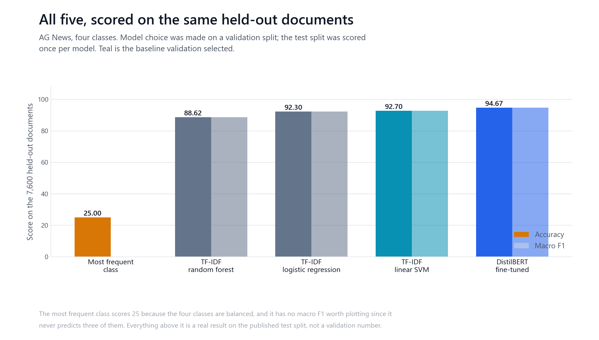
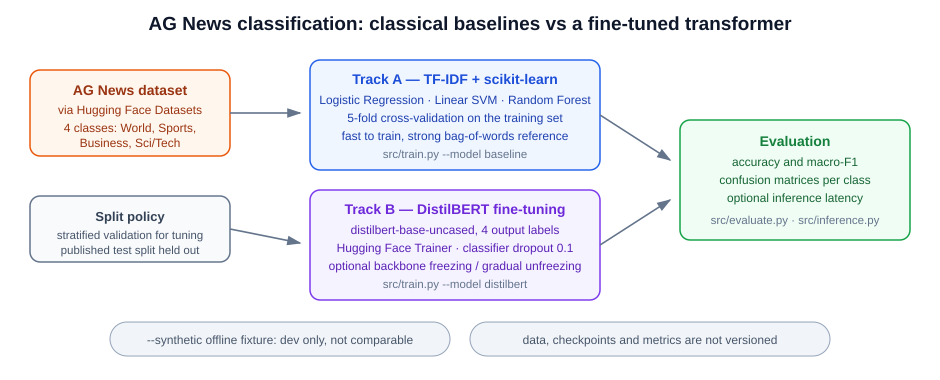
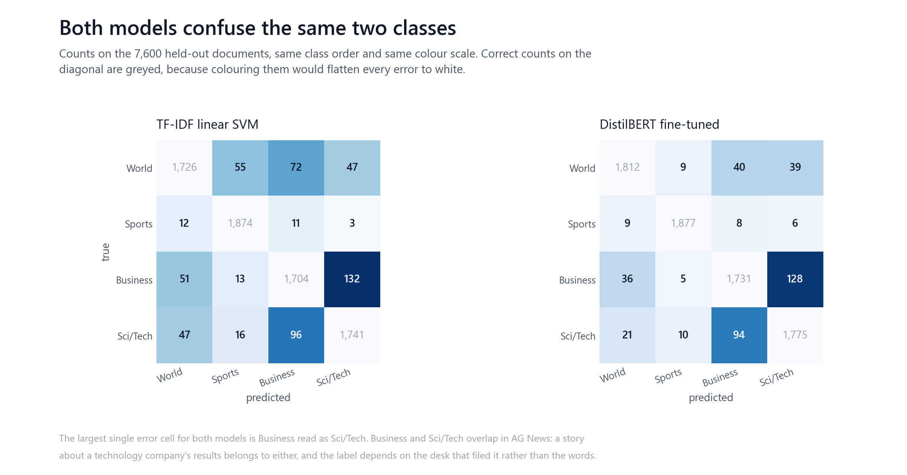
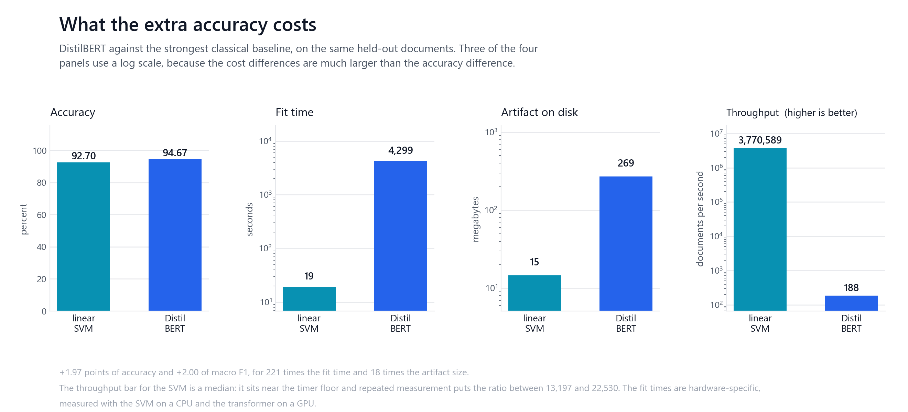

# AG News: a strong classical baseline against one transformer fine-tune

AG News is a four-way topic classification task. Each item is a news headline and
the opening of its story, and the label is the desk it came from: World, Sports,
Business or Sci/Tech. It is a well-worn benchmark, which is what makes it useful
here: the question is not whether either method works, but what the second one
costs.

This repository previously described comparing "classical machine learning
against a fine-tuned transformer" and reported no number for either. AG News is
public and downloads in seconds, so the comparison is now run and recorded.

The result is a real improvement that is smaller than its price tag. A linear SVM
over TF-IDF features reaches 92.70 percent on the published test split after a
19.46 second fit. DistilBERT, fine-tuned once at a configuration fixed in advance,
reaches 94.67 percent after 4,298.8 seconds on a GPU.



## Why run the comparison at all

The interesting question about a transformer on a task like this is not accuracy
in isolation. Both methods clear 92 percent, and a number on its own does not say
whether the extra two points are worth a model that is 18 times larger on disk and
thousands of times slower per document. That trade only becomes visible when the
same held-out documents are scored by both and the costs are recorded next to the
scores, which is what this repository now does.

## Dataset

AG News, through Hugging Face Datasets, using the published splits.

| Split | Rows | Use |
| --- | --- | --- |
| train | 108,000 train | fitting both models |
| validation | 12,000 validation | every model and epoch choice |
| test | 7,600 held-out | scored once per model, chooses nothing |

The 120,000 published training rows are split 90/10 into the train and validation
parts above, stratified, seed 42. The published 7,600-row test split is used as
distributed. All four classes are balanced, at 1,900 test documents each.

### Contamination audit

Before trusting any accuracy on a public benchmark, it is worth asking whether the
test split overlaps training. **No exact train and test overlap was found; 14
normalised text matches were observed in the 7,600-example published test set**,
which is 0.18 percent of it. Normalising lowercases, strips punctuation and
collapses whitespace, so it catches reformatting that an exact comparison misses.
None of those 14 carries a label that disagrees with its training counterpart.

That is a clean result, not a guarantee. It says the specific overlap this probe
looks for is not present at any material scale. It does not rule out
near-duplicates that survive neither exact nor normalised matching, and it says
nothing about whether the pretraining corpus behind `distilbert-base-uncased` saw
these news stories, which is unknowable from here and applies to the transformer
only. `tests/test_leakage.py` checks that the probe finds contamination when
contamination is injected, because otherwise its silence would mean nothing.

## Evaluation protocol



Every model is fitted on the training rows only. Model choice, and the choice of
which fine-tuning epoch to keep, are made on validation. The test split is scored
once per model, after those choices are settled, and it never selects anything.

Each model is saved together with the preprocessing that produced its inputs, and
loaded back the same way. That is not a formality: this repository previously
loaded a saved classifier and then fitted a fresh TF-IDF vectoriser to feed it,
which produces a different vocabulary and therefore a model reading columns that
mean something else. Both defects are described under Artifacts below.

## The classical baseline

TF-IDF over 1 and 2 grams, minimum document frequency 3, sublinear term
frequency, fitted on the training rows and yielding 200,000 features.

| Model | Test accuracy | Macro F1 |
| --- | --- | --- |
| DistilBERT | 94.67 | 94.68 |
| TF-IDF, linear SVM | 92.70 | 92.68 |
| TF-IDF, logistic regression | 92.30 | 92.29 |
| TF-IDF, random forest | 88.62 | 88.56 |
| Most frequent class | 25.00 | not meaningful |

The transformer row is included so the five sit on one scale; it is described in
full below.

Validation selected the linear SVM at 93.01 percent, before any test score was
looked at. It is the baseline every comparison below uses. The most frequent class
scores exactly 25.00 because the classes are balanced.

## The transformer

One fine-tune, at a configuration fixed before the run and not revisited
afterwards.

| Setting | Value |
| --- | --- |
| Base checkpoint | `distilbert-base-uncased` |
| Tokenizer | the one saved with the model, from the same checkpoint |
| Head | sequence classification, 4 labels, randomly initialised |
| Epochs | 2 epochs |
| Batch size | batch size 64 |
| Learning rate | learning rate 5e-05 |
| Optimizer | AdamW, betas 0.9 and 0.999, eps 1e-08, weight decay 0.01 |
| Scheduler | LinearLR, factor 1.0 to 0.0 over all 3,376 steps |
| Sequence length | max sequence length 128, dynamic padding per batch |
| Seed | seed 42 |
| Parameters | 66,956,548 parameters |
| Hardware | Intel Arc Pro 140T GPU, 48 GB, through torch 2.11.0+xpu |
| Peak device memory | 4.11 GB |

Validation accuracy was 94.26 after the first epoch and 94.93 after the second, so
**epoch 2 was chosen**. Total training time was 4,298.8 seconds, about 72 minutes.

### On the restarts

This run was started three times. Neither restart was hyperparameter tuning and
none followed from seeing a score.

The first was stopped because it saved neither the fine-tuned weights nor its
predictions, so it could not have supported artifact provenance, confusion
matrices or error analysis. The second was stopped six minutes in, before any
result existed, because the measured step rate put its finish inside minutes of a
wall-clock limit that would have killed it. The third ran to completion and is the
one reported here. The configuration in the table above was identical in all
three.

## The comparison

Both scored on the same 7,600 held-out documents.

| | Linear SVM | DistilBERT | Difference |
| --- | --- | --- | --- |
| Test accuracy | 92.70 | 94.67 | +1.97 points |
| Macro F1 | 92.68 | 94.68 | +2.00 points |
| Errors | 555 | 405 | 150 fewer |
| Fit time | 19.46 s | 4,298.8 s | 221 times |
| Artifact on disk | 14.6 MB | 268.8 MB | 18 times |
| Throughput | 3,770,589 docs/s | 187.7 docs/s | see below |

DistilBERT wins, by +1.97 points of accuracy and +2.00 of macro F1, removing
27.0 percent of its errors. It pays 221 times the fit time and 18 times the artifact
size for that, and it is thousands of times slower per document.

The throughput gap is given as a range rather than a figure. DistilBERT processes
187.7 documents per second, which is measured reliably. The SVM's forward pass
over an already vectorised matrix takes a few milliseconds for all 7,600 rows,
close enough to the timer floor that seven repeated measurements span 2,477,103 to
4,228,800 documents per second. The ratio is somewhere between 13,197 to 22,530
times. Pinning that to one number, or even to an order of magnitude, is more
precision than the measurement supports, and an earlier version of this file
quoted a single multiple that moved by a factor of five between identical runs.

Read plainly: on AG News a linear SVM already captures most of the available
classification performance at a small fraction of the cost, and the transformer
buys roughly two points on top of it. Whether two points justify a model that
takes 221 times as long to fit, occupies 18 times the disk and answers four orders
of magnitude fewer documents per second is a deployment decision, not an accuracy
one.

## Per-class results

Precision, recall and F1 on the test split, 1,900 documents per class.

**TF-IDF, linear SVM**

| Class | Precision | Recall | F1 |
| --- | --- | --- | --- |
| World | 94.01 | 90.84 | 92.40 |
| Sports | 95.71 | 98.63 | 97.15 |
| Business | 90.49 | 89.68 | 90.09 |
| Sci/Tech | 90.54 | 91.63 | 91.08 |

**DistilBERT**

| Class | Precision | Recall | F1 |
| --- | --- | --- | --- |
| World | 96.49 | 95.37 | 95.92 |
| Sports | 98.74 | 98.79 | 98.76 |
| Business | 92.42 | 91.11 | 91.76 |
| Sci/Tech | 91.12 | 93.42 | 92.26 |

Both models order the classes the same way. Sports is easiest for both, Business
hardest for both, and the transformer does not change that. Its largest gain is on
World, up 3.52 F1 points; its smallest is on Sci/Tech, up 1.18.

## Where the errors are



The dominant confusion pair for both models is **Business read as Sci/Tech**: 132
documents for the SVM and 128 for DistilBERT. With the reverse direction included,
Business and Sci/Tech account for 228 of the SVM's 555 errors and 222 of
DistilBERT's 405.

That is the finding worth pausing on. The transformer removes 150 errors overall
but only 6 of them come from the pair that causes the most trouble. Business and
Sci/Tech genuinely overlap in AG News: a story about a technology company's
results belongs to either, and which label it carries depends on the desk that
filed it rather than on the words in it. No amount of language modelling
disambiguates a distinction the labels do not draw consistently.

The gains come from the easier confusions instead. World misread as Business falls
from 72 to 40, and World misread as Sports from 55 to 9.

## Error overlap

The two models are not nested. DistilBERT is not simply right wherever the SVM is.

| | Count |
| --- | --- |
| SVM wrong | 555 |
| DistilBERT wrong | 405 |
| Both wrong | 284 |
| Only the SVM wrong | 271 |
| Only DistilBERT wrong | 121 |

Of DistilBERT's 405 errors, **284 of them** are documents the SVM also gets wrong,
which is 70 percent. It fixes the 271 the SVM missed and breaks the 121 the SVM had
right. The net is the 150 improvement above.

The 284 both models miss are the ones least likely to be fixed by more of the same
kind of model, and they are concentrated in the Business and Sci/Tech pair. The
121 that only DistilBERT gets wrong (121) are the reminder that a higher average
is not a uniform improvement: swapping models changes which documents you get
wrong, not only how many.

`src/error_analysis.py` selects the examples in `results/benchmark.json` by rule
from the confusion matrix rather than by eye, and drops any category with no
mistakes behind it. Entity-heavy items, headlines carrying six or more capitalised
tokens after the first, make up 72.1 percent of the SVM's errors and 69.6 percent
of DistilBERT's. A short-item category was defined and produced nothing, because
no AG News item that either model got wrong was under twelve words.

## Cost against quality



The fit-time comparison is hardware-specific and should be read as such: the SVM
was fitted on a CPU and the transformer on a GPU. Moving the transformer to a CPU
would widen the gap, not close it. The per-document figures are batched throughput
on already-preprocessed inputs for both, so they compare model forward cost rather
than end-to-end request latency.

## Artifacts

Trained artifacts are not committed, because they are large and rebuildable.
`results/benchmark.json` records each directory's file names, byte sizes and
SHA-256 prefixes, so a number in this README can be traced to the bytes that
produced it.

| Directory | Contents | Size |
| --- | --- | --- |
| `models/tfidf-linear-svm/` | `model.joblib`, `vectorizer.joblib`, `metadata.json` | 14.6 MB |
| `models/distilbert-ag-news/` | `model.safetensors`, `config.json`, `tokenizer.json`, `tokenizer_config.json`, `special_tokens_map.json`, `vocab.txt`, `metadata.json` | 268.8 MB |

Each directory holds a model and the preprocessing that belongs to it. Two bugs
made that necessary:

`src/evaluate.py` loaded a saved classifier and then fitted a **fresh TF-IDF
vectoriser** from the training frame to feed it. A vectoriser fitted on any other
text produces a different vocabulary, so the model is handed a matrix of the wrong
width. It raises when the widths differ and scores against columns meaning
something else when they happen to match.

The same function loaded the saved **tokenizer** and then discarded it, tokenising
instead from the base checkpoint default. For DistilBERT the two normally agree,
so this would never have raised. It would only ever have been a wrong number.

Both are fixed, both entry points now refuse to run against an incomplete artifact
directory, and `tests/test_artifacts.py` fails if either substitution returns.

## Reproducing

```bash
pip install -r requirements.txt                 # classical track, tests, figures
pip install -r requirements-transformer.txt     # adds torch and transformers

python -m src.benchmark --track baselines       # about a minute
python -m src.benchmark --track transformer     # about 72 minutes on a GPU
python -m src.error_analysis                    # selects representative mistakes
python -m unittest discover -s tests            # 35 tests
python scripts/figures/generate_figures.py
python scripts/check_repository.py              # README against the recorded results
python scripts/check_reproducibility.py
```

Every number in this README is read from `results/benchmark.json`, and
`scripts/check_repository.py` fails if the two stop agreeing.

**Continuous integration does not fine-tune DistilBERT.** That run needs a GPU and
over an hour, so it is done by hand and its results are committed. What CI does
instead is recompute every recorded transformer metric from the predictions stored
beside it and require exact agreement, rerun the classical track in full, and check
that both artifact records name their own preprocessing. A hand-edited accuracy
fails that check without any GPU being involved.

## Limitations

One dataset, and a well-worn one. AG News is not representative of text
classification generally, and a four-way topic split over news is about as
favourable as bag-of-words features get.

Four coarse classes, two of which genuinely overlap. A large share of the residual
error is a labelling boundary rather than a modelling failure, which limits what
any model can demonstrate here.

One transformer architecture, one fine-tune, two epochs. There is no hyperparameter
sweep on either side, so this compares two configurations rather than two tuned
methods. Validation accuracy was still rising between the epochs, so a longer run
would likely score higher; that run was not made, because the configuration was
fixed in advance and revisiting it after seeing the comparison would have turned a
single predeclared experiment into a search for a preferred answer.

The compute comparison is specific to this hardware, and the SVM and the
transformer were not fitted on the same device.

The classical side had three candidates and the transformer side one, so the
baseline had more opportunity to be selected well.

## Licence

MIT. See [LICENSE](LICENSE).
